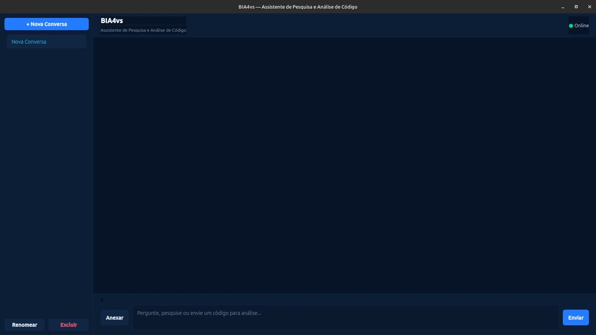

# 🤖 BIA4vs — Assistente Desktop de Pesquisa Técnica e Análise de Código


[](https://github.com/VictorEduardo-coder/BIA4vs/actions/workflows/ci.yml)

> **Pesquisar. Analisar. Desenvolver.**  
> Aplicação desktop modular em **Python (PyQt5)** voltada para consultas técnicas, revisão de arquivos de código-fonte e organização local de histórico de conversas.

<p align="center">
  
</p>

---

## Sobre o Projeto

A **BIA4vs** foi desenvolvida para atuar como uma ferramenta desktop objetiva de apoio à programação e pesquisa técnica. Em vez de tentar ser uma assistente genérica de sistema operacional, ela concentra-se em:

- **Envio e inspeção de arquivos técnicos:** Suporte para leitura de arquivos de código, documentação e PDFs (`.java`, `.py`, `.js`, `.ts`, `.html`, `.css`, `.c`, `.cpp`, `.sql`, `.json`, `.xml`, `.md`, `.txt`, `.pdf`) com limite de segurança de 2 MB por anexo.
- **Processamento assíncrono na interface:** Uso de `QThread` (`AIWorker`) para manter a UI responsiva enquanto consulta pesquisa web, analisa anexos ou aguarda resposta do modelo.
- **Pesquisa externa sob demanda:** Integração com `duckduckgo-search` para buscar referências atualizadas quando a pergunta exige contexto externo.
- **Fallback para diagnóstico estático offline:** Caso não haja acesso ao provedor de IA externo nem a um servidor local (**Ollama**), a aplicação ainda executa análise estática local sobre os arquivos anexados.
- **Histórico local persistido:** Armazenamento de sessões e mensagens em **SQLite** (criado automaticamente em `bia4vs_history.db`, fora do versionamento Git), mantendo janela de contexto de até 12 mensagens por conversa.
- **Renderização técnica:** Respostas formatadas em Markdown com destaque de sintaxe via **Pygments** em tema escuro azulado.

---

## Arquitetura Modular

```text
BIA4vs/
├── app/
│   ├── main.py                      # Inicialização da janela principal PyQt5
│   ├── core/
│   │   ├── ai_engine.py             # Worker assíncrono (QThread), chamadas HTTP e fallback offline
│   │   └── context_manager.py       # Montagem do prompt de sistema, histórico e anexos
│   ├── code_analysis/
│   │   └── analyzer.py              # Diagnóstico estático de arquivos de código anexados
│   ├── files/
│   │   └── attachment_manager.py    # Validação de extensões/tamanho e leitura (inclui pypdf)
│   ├── interface/
│   │   ├── chat.py                  # Área de conversa com renderização Markdown/Pygments
│   │   ├── header.py                # Barra superior e indicador de status
│   │   ├── sidebar.py               # Navegação e histórico de sessões
│   │   └── styles.py                # Paleta e stylesheet QSS da interface
│   ├── research/
│   │   └── search_engine.py         # Busca externa via DuckDuckGo e formatação de contexto
│   └── storage/
│       └── conversation_history.py  # Persistência das conversas e mensagens em SQLite
├── config/
│   └── settings.py                  # Configurações, limites, extensões permitidas e system prompt
├── docs/images/
│   └── bia4vs-interface.webp        # Captura da interface desktop
├── requirements.txt
└── LICENSE
```

---

## Tecnologias Utilizadas

- **Linguagem:** Python 3.10+
- **Interface Gráfica:** PyQt5
- **Persistência Local:** SQLite (`sqlite3`)
- **Pesquisa e Leitura de Arquivos:** `duckduckgo-search`, `pypdf`, `requests`
- **Formatação de Respostas:** `markdown`, `Pygments`
- **Integração com LLMs:** Endpoint HTTP compatível com formato OpenAI (provedor externo gratuito ou servidor **Ollama** local)

---

## Como Executar

### 1. Clone o repositório e crie um ambiente virtual

```bash
git clone https://github.com/VictorEduardo-coder/BIA4vs.git
cd BIA4vs
python3 -m venv .venv
source .venv/bin/activate  # No Windows: .venv\Scripts\activate
```

### 2. Instale as dependências

```bash
pip install -r requirements.txt
```

### 3. (Opcional) Configure um modelo local via Ollama

Por padrão, a aplicação tenta o endpoint remoto configurado em `config/settings.py` e faz fallback para um servidor local compatível com a API OpenAI (como o **Ollama** em `http://localhost:11434/v1/chat/completions`). Você pode sobrescrever essas opções com variáveis de ambiente:

```bash
export BIA4VS_LOCAL_URL="http://localhost:11434/v1/chat/completions"
export BIA4VS_MODEL="llama3"
```

### 4. Inicie a aplicação

```bash
python3 -m app.main
```

O banco de dados local `bia4vs_history.db` será criado automaticamente na primeira execução.

---

## Testes Automatizados e CI

A suíte de testes unitários usa a biblioteca padrão `unittest` (sem depender de interface gráfica ou serviços externos) cobrindo análise estática (`CodeAnalyzer`), validação/leitura de anexos (`AttachmentManager`), persistência SQLite isolada (`ConversationHistory`) e montagem da janela de contexto (`ContextManager`):

```bash
python3 -m unittest discover -s tests -v
```

Os testes também são executados automaticamente no **GitHub Actions** (`.github/workflows/ci.yml`) em Python 3.11 e 3.12 a cada `push` ou `pull request`.

---

## Princípios de Segurança Adotados

- A análise de arquivos é estritamente passiva: a aplicação **não executa código enviado** nem modifica arquivos locais automaticamente.
- Extensões aceitas e tamanho máximo (2 MB) são validados em `config/settings.py` antes da leitura.
- O arquivo de histórico local (`*.db`) é mantido no `.gitignore` para evitar versionamento acidental de conversas pessoais.

---

## Licença

Distribuído sob a licença **MIT**. Consulte o arquivo [LICENSE](./LICENSE) para mais detalhes.
